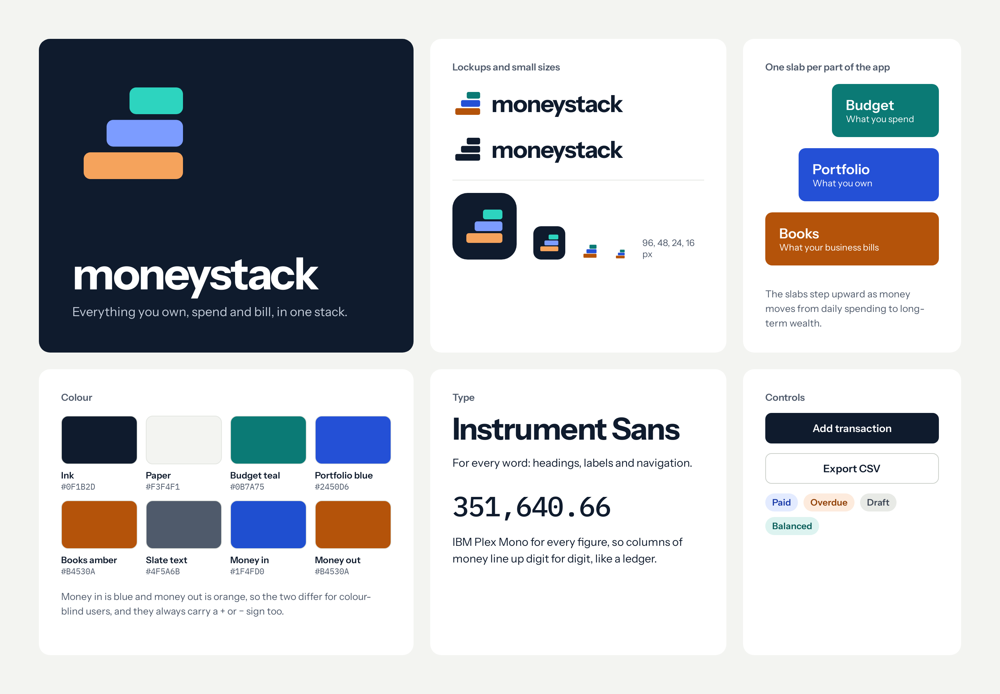
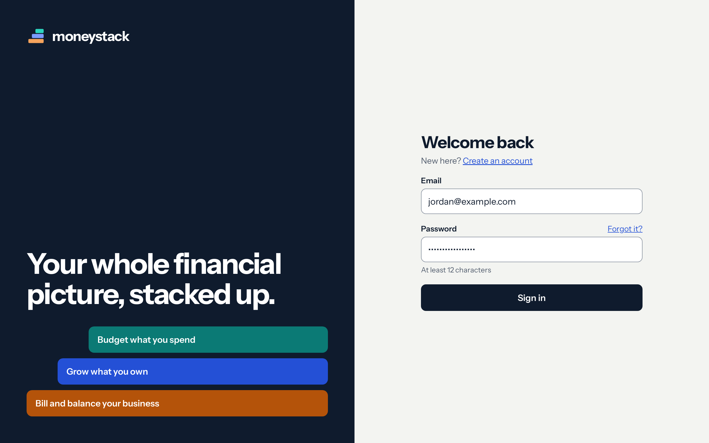
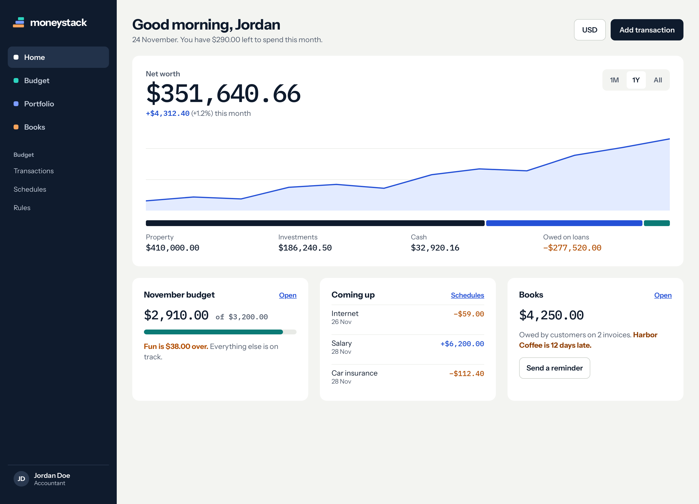
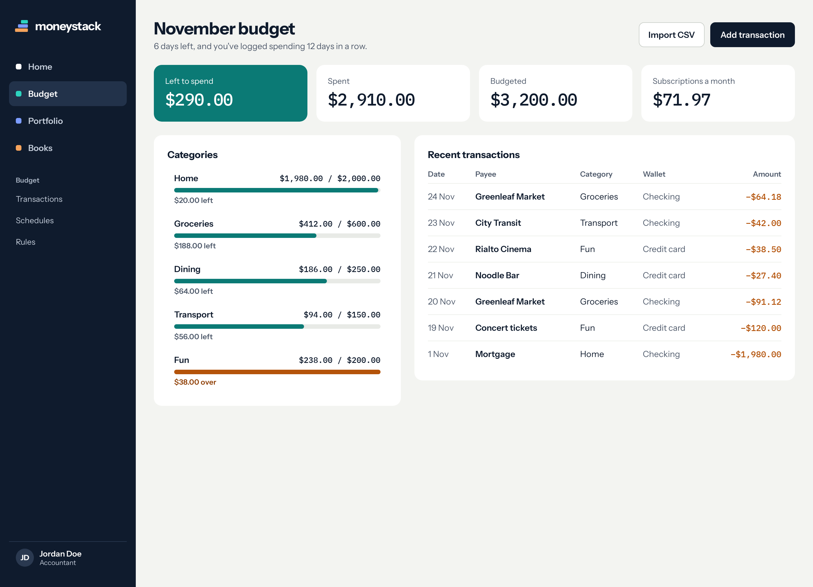
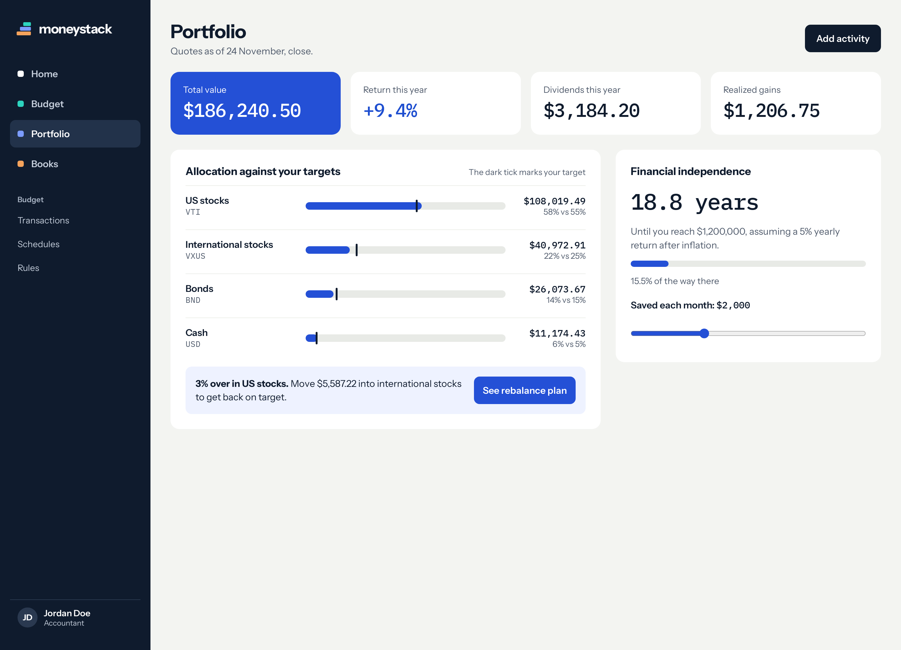
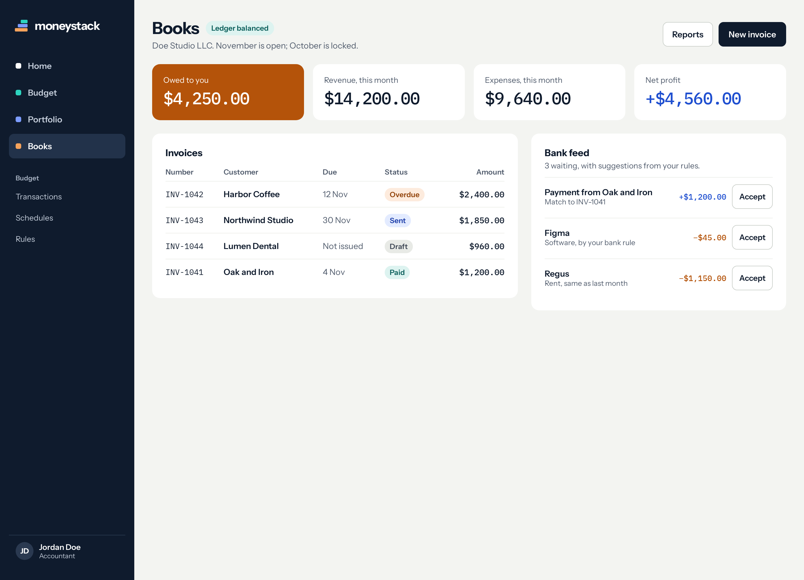
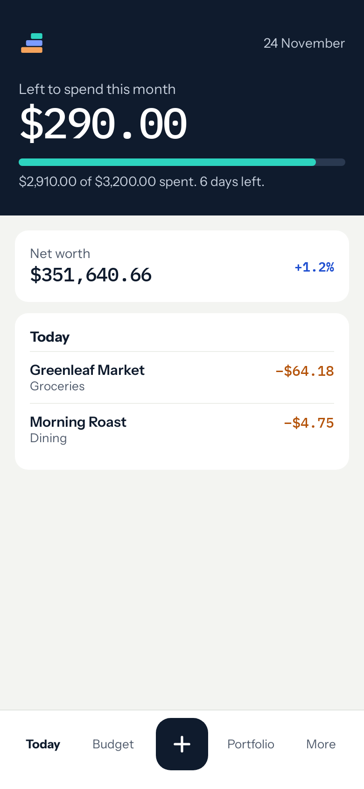
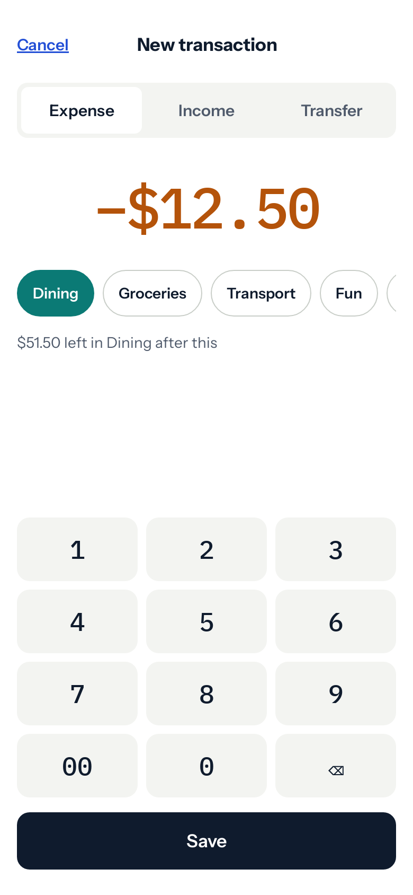

# moneystack design

The proposed look for a moneystack web and phone app. The API exists today, but no UI has been built yet, so
these images are mock-ups. All names and figures in them are sample data.

## Brand

The mark is three rising slabs, one for each part of the app: teal for Budget, blue for Portfolio and amber
for Books.

| File | Use it for |
|---|---|
| [logo-mark.svg](brand/logo-mark.svg) | The mark on light backgrounds |
| [logo-mark-on-dark.svg](brand/logo-mark-on-dark.svg) | The mark on dark backgrounds |
| [app-icon.svg](brand/app-icon.svg) | App icon |
| [favicon.svg](brand/favicon.svg) | Browser tab, with slightly thicker slabs for small sizes |
| [logo-lockup-light.png](brand/logo-lockup-light.png), [logo-lockup-dark.png](brand/logo-lockup-dark.png) | Mark and name together |

The lockups are PNGs because the name is set in Instrument Sans. An SVG would depend on that font being installed.

## Screens

### Sign in

### Home

Net worth first, then the month's budget, upcoming bills and money owed by customers.

### Budget

### Portfolio

### Books

Only accountants can reach this part of the API, so other users shouldn't see it.

### Phone

 

## Not in the API yet

- Password reset, which the sign-in screen links to.
- A single call for Home: it would combine figures from all three modules.
